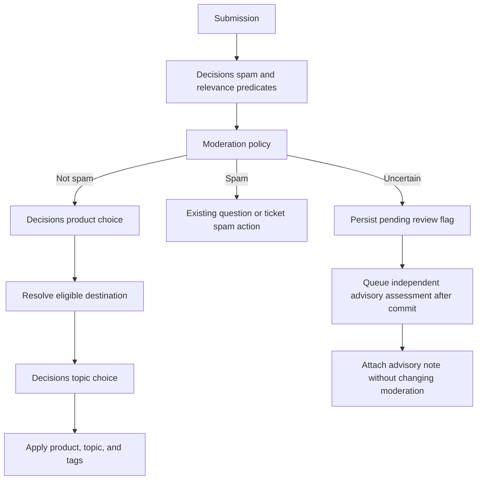

# Content Classification

## Scope and pipeline

New support questions and Zendesk submissions are classified in Celery workers. The pipeline screens Mozilla-wide spam first, resolves a product for admitted requests, and then selects a topic from that product's taxonomy. Answer heuristics, discussion forums, live-chat adoption, and translation are separate systems.



Spam and uncertain requests do not run product or topic selection. Product classification runs for every admitted request, including ticket configurations that bypass spam moderation.

Routing uses the actual submitter and an explicit `forum` or `ticket` channel; it does not create anonymous identities or apply login-exception rules. Tickets with no stored user—legacy loginless Mozilla Accounts submissions or deleted owners—retain their submitted product and can still receive a topic.

## Spam policy

`kitsune/llm/spam/classifier.py` uses two named Decisions predicates:

- `spam`: estimated probability that the content violates the Mozilla-wide spam policy.
- `relevance_uncertainty`: estimated probability that uncertain Mozilla relevance or unfamiliar feature terminology is the **only** potential spam concern.

The model receives subject, body, submission channel, locale, and a neutral Mozilla product catalog with descriptions and known-legitimate examples. It does not receive the user's selected product, selected topic, or an earlier verdict. A support request for another Mozilla product is not spam because it was submitted under the wrong product. Mozilla-related advertisements, scams, and abuse remain spam.

Private-ticket policy allows personal contact/account information that would be suspicious in public solicitation. Non-English text and unfamiliar feature names are not spam signals.

### Probability routing

The defaults are configurable Django settings, read when applying the decision:

| Condition | Outcome |
| --- | --- |
| `P(spam) < SPAM_REVIEW_PROBABILITY` | Not spam; continue routing |
| Review cutoff reached, but reject cutoff not reached | Pending human review |
| Reject cutoff reached and relevance-only uncertainty below its cutoff | Spam action |
| Reject cutoff reached, but relevance-only uncertainty reaches its cutoff | Pending human review, not automatic spam |
| Either answer is refused, missing, malformed, or unavailable | Pending human review |

Default spam cutoffs are `0.50` for review and `0.80` for spam. Default relevance-only review cutoff is `0.50`. Cutoffs must be finite probabilities; the spam review cutoff must be lower than the reject cutoff. Invalid configuration raises a configuration error rather than silently changing moderation.

The relevance guard replaces the old prompt-only confidence ceiling. It protects plausible support requests about unfamiliar features while explicitly excluding independent advertising, abuse, or other spam evidence.

Decisions probabilities are estimates, not guarantees of calibrated accuracy. Evaluate false positives, recall, and review volume on labeled support content when adjusting the cutoffs.

## Product and topic routing

`kitsune/llm/categorization/classifiers.py` uses constrained choices with unique runtime keys mapped to database IDs. Product and topic titles are not unique identifiers.

### Product selection

The product list is queried from the database for each classification; adding or archiving a product changes the candidates without code changes. The subject/body, user-selected product, product descriptions, and platform distinctions guide primary-product selection. The selection is a weak prior, not an instruction to agree. An explicit unknown/ambiguous/no-primary-product choice permits abstention.

- Matching the current product retains it.
- A different eligible product is applied only if its supplied-option probability reaches `PRODUCT_REASSIGN_PROBABILITY` (default `0.90`). The separate API `confidence` field is not used as this probability.
- Mozilla Accounts sources use the stricter of that cutoff and `MOZILLA_ACCOUNT_REASSIGN_PROBABILITY` (default `0.95`). The prompt also protects generic account-access and lockout requests from incidental product mentions.
- Ambiguous, refused, unavailable, or low-probability choices retain the current selection and record the reason for abstention.
- Questions without a selected product can receive a confident eligible product. If none can be resolved, they enter content/routing review without requesting an advisory spam assessment.

`eligible_products()` and `eligible_product()` share `ProductSupportConfig.objects.route_support_request()`. Candidates must be active and non-archived, and respect visibility, submission channel, forum locale, subscriptions, and organization routing. Consumers use the single-product lookup to revalidate a moved destination before applying it, rather than rebuilding the full catalog.

Public questions stay in eligible forums. Private tickets stay in eligible Zendesk destinations; classification never publishes ticket content to a public forum.

### Topic selection

The model receives a list of the resolved product's taxonomy topics, with descriptions, examples, and hierarchy paths from `get_taxonomy(..., include_metadata=["description", "examples"], include_ids=True)`. Native choices constrain its answer to those topic IDs or Undefined; it cannot invent a topic or select another product's topic. It should prefer the most specific applicable topic. The original topic hint is dropped when the product changes.

The default taxonomy output remains unchanged for other callers. Only active, visible, product-associated topics included by the existing metadata-filtered hierarchy are offered. Malformed metadata is treated as absent. Missing ancestors or ancestors excluded by that hierarchy also exclude their descendants.

An explicit Undefined choice resolves to `topic_id=None`. Empty catalogs skip the request. `DECISIONS_MAX_CHOICES` names the provider's [255-choice ceiling](https://developers.openai.com/api/reference/resources/decisions/methods/create), including the abstention option, for both product and topic requests. Oversized catalogs explicitly abstain rather than silently truncate. Refusals and service failures do not invent a topic.

Question updates clear an old product's topic, invalidate the cached product slug, and rebuild derived tags. Ticket moves update the actual product, clear the old category/topic, use the destination's topic/category mapping, preserve system/segmentation tags, and select the destination's Zendesk configuration, form, and brand.

## Advisory spam assessment

`kitsune/llm/tasks.py::assess_uncertain_spam` runs only for valid probability-based uncertainty, including the relevance guard. Missing/refused/unavailable Decisions answers receive factual review notes but do not trigger this assessment.

The pending flag exists before the job is published, and publication is deferred until transaction commit. A broker publication failure leaves the content in review; it cannot turn an uncertain ticket into a failed-classification ticket eligible for automatic delivery.

Celery task arguments contain only the flag ID and SHA-256 digests of the initial notes and assessment input. Subject, body, and raw notes are not serialized into broker messages or Celery task-argument context. Classification and advisory workers share `question_payload()` / `ticket_payload()` for subject, body, channel, and locale. The worker reloads the content from the database and verifies the digests before requesting the configured advisory model.

The advisory model independently receives the content and neutral policy/catalog. It does **not** receive the Decisions probability/verdict or the selected product. Its structured assessment contains:

- Suggested verdict: spam, not spam, or uncertain.
- Observed spam signals.
- Observed legitimate-support signals.
- Remaining uncertainty.

This is an independent reviewer assessment, not an explanation of Decisions' internal reasoning. It is advisory: it cannot mark/unmark content, accept a flag, reject a ticket, or change routing.

The job skips deleted content, content edited before assessment, and obsolete flags. Its final note update requires the flag to remain pending with exactly the expected initial notes, preventing it from overwriting a moderator decision or a newer classification. Provider/parser failures use the task's bounded retry behavior and leave the review flag intact.

Moderation templates render note lines separately and autoescape every line, including model-supplied text.

## Entry points, switches, and persisted effects

- `classify_question()` and `classify_zendesk_submission()` in `kitsune/llm/support/classifiers.py` return the staged decision result.
- `question_classifier` runs on new questions when `QUESTION_CLASSIFIER_ENABLED` is enabled. `auto-question-classifier` controls classification; `flagit-spam-autoflag` retains the existing disabled-classifier review fallback.
- Ticket classification is queued by the existing submission flow. `ZendeskConfig.skip_spam_moderation` now skips only spam screening, not product/topic classification.
- Clear question spam is marked as spam and receives the existing accepted bot flag. Uncertain question spam remains visible and receives a pending spam flag.
- Admitted questions persist product/topic changes and an accepted content-moderation flag with score/routing notes.
- Clear ticket spam is sent to the staff spam queue when `zendesk-spam-classifier` is active, otherwise rejected. That pending high-probability case does not request an advisory assessment.
- Ticket spam-screening reviews, including probability uncertainty, relevance-guard cases, refused/malformed answers, and provider unavailability, receive pending spam-reason flags in the staff Zendesk spam queue **regardless of the `zendesk-spam-classifier` switch**. This queue needs staff coverage even when that switch is off. Staff can choose "Removed spam content" to reject the ticket or "No spam found" to deliver it. An explicit routing-review reason still uses the content-moderation queue. Existing content-moderation flags are not migrated automatically. Admitted tickets persist routing fields/tags and are sent through `ZendeskClient`.
- Question classification records the bot in `handled_by` without resolving a pending human review. Stale-question processing excludes flags already classified by the bot, so unresolved-product reviews cannot repeatedly occupy the batch or starve later questions. It preserves a newly pending uncertainty flag rather than overwrite it as accepted. Other existing task failure and failed-ticket delivery behavior is unchanged.
- Re-flagging an existing row as pending clears its previous bot-attempt marker so it can reenter classification, both through the helper and the HTTP flag endpoint. Accepted flags on system-account content retain the existing content-deletion policy; stale batches continue past deleted questions and flags.

The result contract uses `spam_result.probability` and `relevance_uncertainty_probability`, ID-based `product_result`/`topic_result`, the submitted product ID, and an optional JSON-serializable assessment payload. There is no model-written confidence, boolean spam gate, `maybe_misclassified`, or generated-JSON categorization parser.

## Configuration and local operation

Configuration lives in Django settings; environment-backed values are documented in `.env-dist`:

| Setting | Purpose |
| --- | --- |
| `OPENAI_API_KEY` | Decisions service credential; keep out of source control and chat |
| `OPENAI_BASE_URL` | Global or approved regional endpoint |
| `DECISIONS_MODEL` | Supported Decisions model |
| `DECISIONS_TIMEOUT_SECONDS` | SDK request timeout |
| `DECISIONS_MAX_CHOICES` | Provider choice ceiling, including abstention; not a business product cap |
| `SPAM_REVIEW_PROBABILITY` | Lower spam review boundary |
| `SPAM_REJECT_PROBABILITY` | Automatic spam boundary |
| `SPAM_RELEVANCE_REVIEW_PROBABILITY` | Relevance-only uncertainty guard |
| `PRODUCT_REASSIGN_PROBABILITY` | Automatic product move boundary |
| `MOZILLA_ACCOUNT_REASSIGN_PROBABILITY` | Stricter Accounts-source move boundary |
| `SPAM_ASSESSMENT_MODEL` | Configured advisory model |

The advisory assessment uses `get_llm()` with `SPAM_ASSESSMENT_MODEL`. Restart Django/Celery processes after changing environment values. Keep provider creation centralized: `evaluate_decisions()` for classification, `get_llm()` for advisory assessment, generation, and translation. Changing providers may require updating that factory, not just a model ID.

Example spam policy values:

```dotenv
SPAM_REVIEW_PROBABILITY=0.50
SPAM_REJECT_PROBABILITY=0.80
SPAM_RELEVANCE_REVIEW_PROBABILITY=0.50
```

Apply the products migration that updates the spam-bypass field's description, install dependencies from the lockfile, and configure organization access/data handling before making live requests. Private ticket text changes provider recipient; review the required retention/residency arrangements. API availability is not evidence of model accuracy or measured latency.

### Operational limits and recovery

The Decisions client permits two retries after the initial attempt. With the current default request timeout, the approximate request-attempt exposure is:

| Path | Approximate timeout exposure before backoff |
| --- | --- |
| Spam screening exhausts its three attempts | 90 seconds, then manual review |
| All three sequential classification stages consume three near-timeout attempts | 270 seconds |

These are planning estimates, not measured latency or hard end-to-end deadlines: HTTP timeouts apply to request operations, and retry backoff adds time. The full-chain estimate requires spam screening to eventually succeed; an exhausted spam screen stops before product/topic classification.

The default Compose worker consumes classification, email, and retrieval queues in one worker pool. Slow provider requests can occupy that pool and delay unrelated work. Mitigations are lowering `DECISIONS_TIMEOUT_SECONDS` or routing classification to a dedicated queue with separate worker capacity. Reducing the SDK's fixed retry count requires a code change. Merely adding a queue to the same worker does not isolate capacity.

Provider-outage reviews are not automatically replayed when the provider recovers. Questions retain pending spam flags, and tickets remain held for staff review; the stale-question processor does not select those flags. Explicit moderation or operator recovery is required. This is manual-review fallback, not a pause-and-resume workflow.

Staff approval of an uncertain ticket uses its current routing fields; it does not automatically resume product/topic classification. The existing failed-ticket delivery safety net for unexpected processing exceptions is separate from these pending provider-outage reviews.

Run behavioral checks through Docker:

```sh
docker compose run --rm web ./manage.py test kitsune.llm.tests kitsune.products.tests.test_utils kitsune.questions.tests.test_utils kitsune.customercare.tests.test_utils kitsune.customercare.tests.test_tasks --keepdb -v 2
```

These checks use controlled provider outputs to verify probability boundaries, abstention, eligibility, database identity, advisory isolation, concurrency, and moderation transitions. Live model quality and latency require authenticated evaluation on representative, appropriately handled content.
